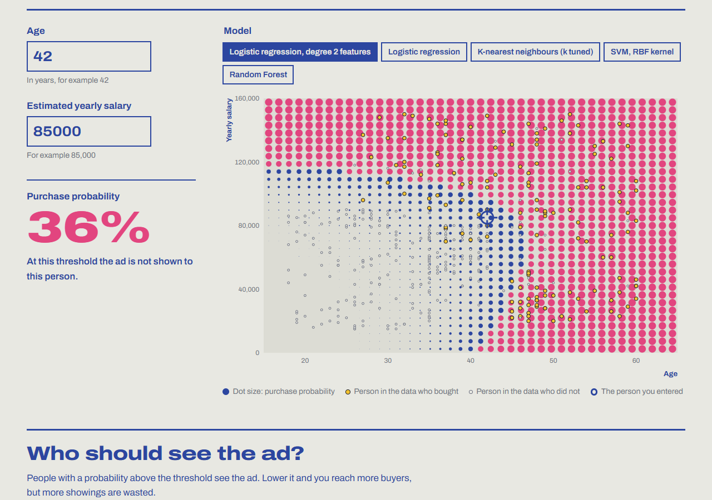
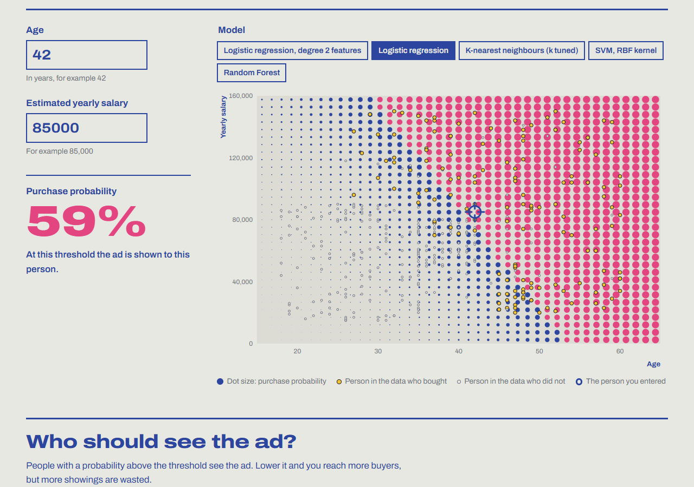
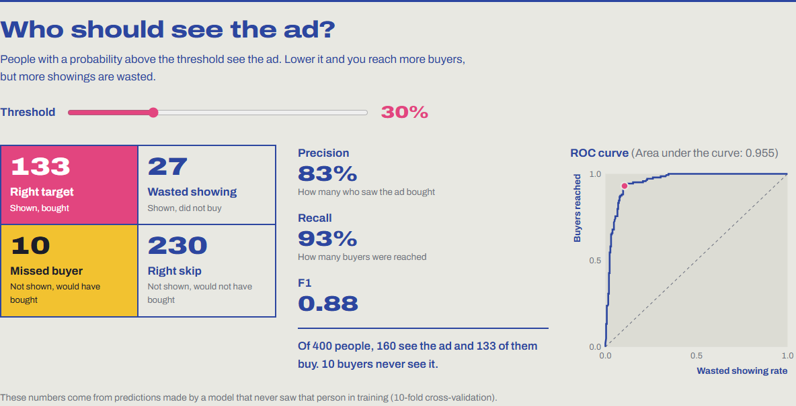
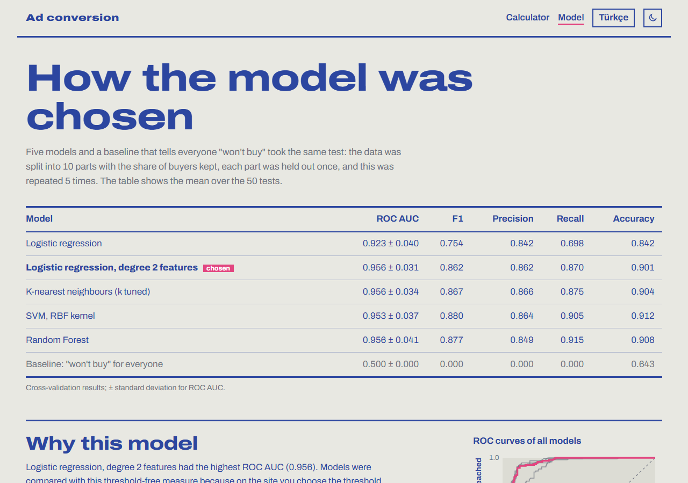
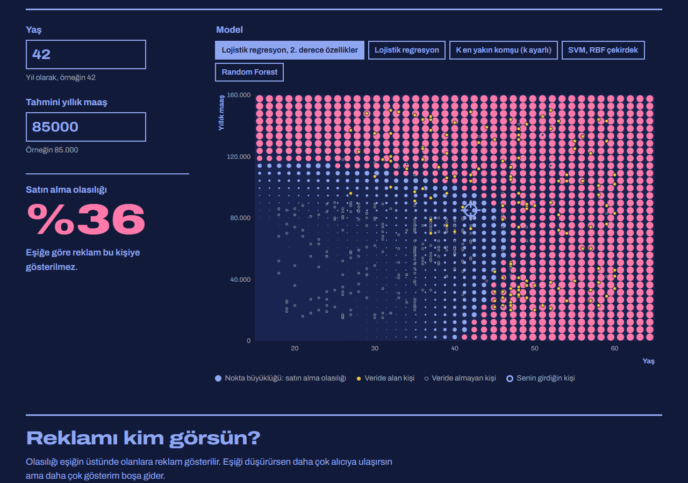
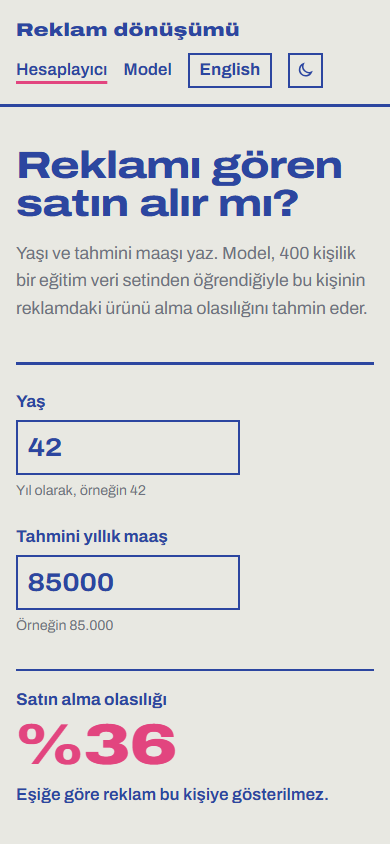

# Ad Conversion Prediction

**English** | [Türkçe](README.tr.md)

Predict whether someone who sees an ad will buy, from their age and salary. A Python machine learning pipeline compares five classifiers with repeated stratified cross-validation and exports their probability maps; a small website draws each model's decision map in halftone dots, lets you move the decision threshold and shows precision, recall, the confusion matrix and the ROC curve as you do.

**Live demo:** [conversion.miracdeprem.com](https://conversion.miracdeprem.com)



> **About the data:** a widely used teaching dataset of 400 people (`Social_Network_Ads.csv`). It is not data from a real campaign, so the results show how the methods work, not how real customers behave.

## Features

**Website**
- Purchase probability for an age and salary you enter, with a warning outside the range of the data
- Decision map: the probability over age × salary for each of the five models, drawn as halftone dots whose area follows the probability; dots above the threshold turn pink (the ad is shown)
- Threshold slider ("who should see the ad?"): the confusion matrix in plain words (right target, wasted showing, missed buyer, right skip), precision, recall, F1 and the ROC curve update as you move it
- Model page: comparison table, why accuracy misleads on this data, ROC curves of all models, the gender check and a model card
- Turkish and English on their own addresses, light and dark theme, works on phones and with the keyboard
- No server: everything runs in the browser from three JSON files; nothing you enter is sent or stored

**Training pipeline**
- Validates the data (columns, gender values, ranges, a 0/1 target with both classes) and drops the user ID
- Compares logistic regression, logistic regression with degree 2 features, KNN with k tuned in a nested search, an RBF SVM and Random Forest against a baseline that always predicts "won't buy"
- Repeated stratified 10-fold cross-validation (50 splits); ROC AUC, F1, precision, recall and accuracy
- Runs the same comparison with gender added, to show that it adds nothing
- Exports each model's probabilities on a 101 × 101 age × salary grid and out-of-fold predictions for the threshold view
- Shared fixtures check the JavaScript against scikit-learn (grid reading, confusion matrices, ROC AUC)

## Screenshots

| | |
|---|---|
|  |  |
|  |  |

<p align="center"></p>

## How it works

```
data/social-network-ads.csv ──► validate ──► compare 5 models ──► choose ──► export ──► web/metrics.json
                                            (stratified 10-fold    (1-SE rule,           web/grid.json  (101 × 101 per model)
                                             CV × 5, ± gender)      ROC AUC)             web/data.json  (points + out-of-fold)
                                                                                              │
browser: age + salary ──► bilinear read of the grid ──► probability, map, threshold metrics, ROC
```

1. **Validate.** [`adconv/data.py`](adconv/data.py) checks the file and keeps age, salary, gender (for the comparison only) and the target.
2. **Compare.** [`adconv/models.py`](adconv/models.py) runs every candidate on the same `RepeatedStratifiedKFold` splits. Scaling lives inside the pipeline, so it is learned from the training folds only; KNN's k is chosen inside each training fold.
3. **Choose.** The simplest model within one standard error of the best ROC AUC wins. ROC AUC is threshold-free, which matters because the threshold is left to the user.
4. **Export.** [`adconv/export.py`](adconv/export.py) writes every model's probability on a grid. Random Forest and SVM cannot be written as a formula, but a grid works for any model.
5. **Show.** [`web/src/predict.js`](web/src/predict.js) reads the grid with bilinear interpolation; [`web/src/metrics.js`](web/src/metrics.js) computes the confusion matrix and ROC curve from out-of-fold predictions, so the numbers come from people each model never saw.

## Results

Repeated stratified 10-fold cross-validation (50 splits):

| Model | ROC AUC | F1 | Precision | Recall | Accuracy |
|---|---|---|---|---|---|
| Logistic regression | 0.923 ± 0.040 | 0.754 | 0.842 | 0.698 | 0.842 |
| **Logistic regression, degree 2 features**, chosen | 0.956 ± 0.031 | 0.862 | 0.862 | 0.870 | 0.900 |
| K-nearest neighbours (k tuned) | 0.956 ± 0.034 | 0.867 | 0.866 | 0.875 | 0.904 |
| SVM, RBF kernel | 0.953 ± 0.037 | 0.880 | 0.864 | 0.905 | 0.912 |
| Random Forest | 0.956 ± 0.041 | 0.877 | 0.849 | 0.915 | 0.908 |
| Baseline (always "won't buy") | 0.500 | 0.000 | 0.000 | 0.000 | 0.642 |

Adding gender changes ROC AUC by at most 0.002 for any model.

## Tech Stack

- **Python**, **pandas**, **NumPy**, **scikit-learn** for training and evaluation
- **HTML**, **CSS** and **JavaScript** with no framework and no build step; the map and ROC charts are hand-written SVG
- **pytest** and Node's built-in test runner (`node --test`)
- **Vercel** for hosting, with a strict Content Security Policy

## Installation

Open [conversion.miracdeprem.com](https://conversion.miracdeprem.com), or run it locally with Python and Node.js:

```bash
git clone https://github.com/MrcDprm/ad-conversion-prediction.git
cd ad-conversion-prediction
python -m venv .venv
.venv/Scripts/activate          # Windows; on macOS/Linux: source .venv/bin/activate
pip install -r requirements-dev.txt
```

Train, compare and export (writes `web/metrics.json`, `web/grid.json` and `web/data.json`), then refresh the shared test fixtures:

```bash
python -m adconv.train
python -m adconv.fixtures
```

Run the tests and the website:

```bash
python -m pytest
npm test
npx serve web                   # then open the address it prints
```

The HTML pages, `sitemap.xml` and `robots.txt` are generated from `web/pages/` and `web/src/messages.js` in both languages. After changing a text, run `npm run build:pages`; a test fails if the pages are out of date.

## Project Structure

```
adconv/        data validation, model comparison, export, training command, fixtures
tests/         pytest tests
data/          the dataset
scripts/       build-pages.mjs: generates the Turkish and English pages
web/           the website (Vercel serves this folder)
  pages/       page templates
  src/         predict.js, metrics.js, map.js, app.js, model-page.js, messages.js
  tests/       JavaScript tests and shared fixtures
```

## What I Learned

- On imbalanced data, accuracy hides a lot. A model that never finds a buyer is 64% accurate here; ROC AUC, precision and recall tell the real story.
- Choosing a threshold is a business decision, not part of the model. Out-of-fold predictions let me show what each threshold costs without flattering the numbers with training data.
- A curved boundary does not always need a complex model. Adding the squares and the product of age and salary let plain logistic regression match Random Forest and SVM.
- Tuning a hyperparameter on the same data you score it on inflates the result. The old version did that for KNN; nested cross-validation fixes it.
- Not every available column should go into a model. Gender added nothing here, and using it to target ads would raise a fairness question.
- Exporting models as probability grids made any classifier usable in the browser, and testing the JavaScript against scikit-learn kept the two in step.
- A subdomain starting with `ads.` is blocked by ad blockers, so the site moved to `conversion.`: a small lesson in naming.

## License

[MIT](LICENSE)
